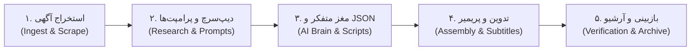

# Zighoosh ReelForge (P-09)

<p align="center">
  
  
  
  
  
</p>

> **Zighoosh ReelForge** یک نرم‌افزار دسکتاپ مدرن، مینیمال و هوشمند برای ویندوز است که پایپلاین تولید ویدیوهای عمودی اینستاگرام (Reels) از آگهی‌های استخدامی وب‌سایت [IranOilJob](https://iranoiljob.com) را به صورت خودکار هدایت می‌کند.

---

## 🎨 زبان طراحی (Apple & Google Minimalist Design)
- **پالت رنگی Dark Mode:** زمینه تیره مخملی (`#0F1015`)، کارت‌های با انحنای نرم و بردرهای ظریف ۱ پیکسلی.
- **تایپوگرافی خوانا:** سازگار با متون فارسی و انگلیسی، سیستم وضعیت با نشانگرهای رنگی (`StatusPill`).
- **معماری ناهمگام (Non-blocking Asynchronous Threads):** تمامی ارتباطات شبکه، وب‌اسکرپینگ، مدل‌های هوش مصنوعی صوتی و انتقال فایل‌ها در پس‌زمینه اجرا شده و رابط کاربری همواره روان باقی می‌ماند.

---

## 🚀 جریان کاری ۵ مرحله‌ای (5-Step Pipeline)



### ۱. استخراج و دریافت آگهی (Ingest & Scrape)
- استخراج هوشمند با شناسه آگهی از API ایران اویل جاب.
- دریافت کامل آرایه مهارت‌های تخصصی، تحصیلات، سابقه کاری و شرایط اقماری/میدانی.
- دانلود خودکار باکیفیت لوگوی شرکت کارفرما و ساخت پرامپت ۵ محوره کالبدشکافی میدانی برای **Gemini Deep Research**.

### ۲. نتیجه دیپ‌سرچ و هدایت سناریو (Research & Prompts)
- کادر چسباندن (Paste) مستقیم نتیجه کالبدشکافی عمیق بازار کار.
- ذخیره‌سازی خودکار در `deep_search_result.md` و تولید سند پکیج تجمیعی `combined_dossier_for_gemini.md`.
- دکمه‌های کپی تک‌کلیک پرامپت سناریونویسی وایرال (`@oiljob-role-explorer`) و صدور خروجی استاندارد (`@oiljob-json-exporter`).

### ۳. مغز متفکر و تفکیک اسناد (AI Brain & JSON)
- اعتبارسنجی جامع ساختار JSON خروجی جمینای.
- خردسازی خودکار به اسناد مدولار در پوشه `02_AI_Brain_JSON`:
  - `flow_ready_script.txt`: اسکریپت‌های تفکیک‌شده پلان‌های ۱ تا ۶ گوگل فلو همراه با نریشن‌های اعراب‌گذاری‌شده.
  - `music_prompt.txt`: پرامپت ساخت موسیقی پس‌زمینه متناسب با تم صنعت نفت و انرژی.
  - `thumbnail_bg_prompt.txt`: پرامپت تولید پس‌زمینه پوستر کاور ویدیو.
- آماده‌سازی ساختار پوشه‌های ۶ گانه در `03_Raw_DropZone`.

### ۴. تدوین، زیرنویس و پریمیر (Assembly & Premiere)
- پایش لحظه‌ای حضور راش‌های ویدیویی، تصویری و صوتی پلان‌های ۱ تا ۶ در DropZone.
- مهاجرت ایمن پروژه به پوشه Active Workspace جهت حفظ سلامت پیوندها.
- استانداردسازی نام راش‌ها (`V_Plan_0X.mp4` و `A_Plan_0X.wav`) و استخراج صوت با FFmpeg در صورت نیاز.
- تولید زیرنویس هماهنگ فارسی `.srt` بر پایه الگوریتم هوشمند Forced Alignment با Whisper.
- استقرار خودکار فایل پروژه پریمیر پرو (`.prproj`) و کاور ایلوستریتور (`.ai`) با لینک‌گذاری مدیاها.

### ۵. بازبینی و آرشیو امن (Verification & Archive)
- اعتبارسنجی خودکار حضور فایل رندر نهایی در `06_Final_Exports`.
- پاکسازی انتخابی راش‌های خام و سنگین جهت بهینه‌سازی حافظه دیسک.
- انتقال کل پکیج به آرشیو دائمی و به‌روزرسانی رجیستری مرکزی (`archive_registry.json`).

---

## 📁 ساختار پوشه‌ها و کدهای پروژه

```text
Zighoosh-ReelForge/
├── main.py                       # نقطه ورود و اجرای رابط کاربری دسکتاپ
├── config.json                   # تنظیمات مسیرهای Downloads، Active Workspace و Archive
├── requirements.txt              # پیش‌نیازها و وابستگی‌های پایتون
├── test_pipeline.py              # آزمون خودکار End-to-End تمامی ۵ گام
├── App_Templates/                # قالب‌های مادر پریمیر و ایلوستریتور
│   ├── Template_Reels.prproj
│   └── Template_Thumb.ai
├── core/
│   ├── scraper.py                # استخراج اطلاعات، لوگو، پرامپت دیپ‌سرچ و پکیج تجمیعی
│   ├── json_processor.py         # پارسر و اعتبارسنجی ساختار JSON جمینای
│   ├── workspace_builder.py      # مدیریت ورک‌اسپیس فعال، تغییر نام راش‌ها و تمپلیت‌ها
│   ├── subtitle_engine.py        # موتور تولید زیرنویس هوشمند با Whisper
│   └── archiver.py               # پایش رندر نهایی و بایگانی دائمی
└── ui/
    ├── theme.py                  # سیستم رنگی و استایل دارک اپل/گوگل
    ├── components.py             # کامپوننت‌های مدرن: کارت‌ها، دکمه‌ها و لاگ زنده
    ├── settings_dialog.py        # پنجره تنظیمات مسیرها و مدل صوتی
    └── main_window.py            # پنجره اصلی برنامه با ۵ تب تعاملی
```

---

## 🛠️ راه‌اندازی و نیازمندی‌ها

### پیش‌نیازها:
1. پایتون نسخه ۳.۱۰ یا بالاتر
2. نصب ابزار [FFmpeg](https://ffmpeg.org/) و قرارگیری آن در PATH ویندوز

### نصب وابستگی‌ها:
```bash
pip install -r requirements.txt
```

### اجرای برنامه:
```bash
python main.py
```

### اجرای تست‌های یکپارچه:
```bash
python test_pipeline.py
```

---

## 📄 مجوز و لایسنس
توسعه یافته برای مجموعه **زیگهوش (Zighoosh)** - کلیه حقوق محفوظ است.
